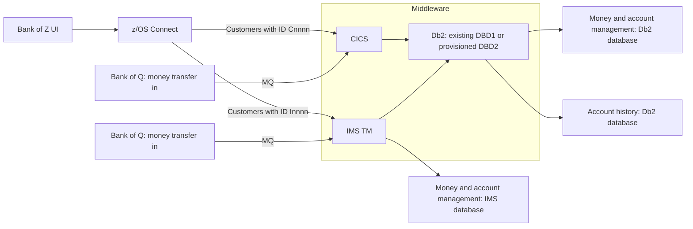

# Bank of Z: Db2 setup and provisioning

This guide covers using an existing Db2 subsystem or provisioning a new one, followed by Bank of Z installation and verification. Paths and subsystem names are examples; adapt them to your environment.

## What gets installed?



The Db2 databases use either the existing DBD1 subsystem or a newly provisioned DBD2 subsystem.

The required Db2, CICS, IMS and MQ products must already be installed for the components you enable. Bank of Z setup creates their application resources; it does not install the middleware products from distribution media.

There are two main installation commands:

| Command | Purpose |
| --- | --- |
| `environment` | Create Bank middleware resources, including a new Db2 subsystem when enabled |
| `install-bank-of-z` | Build and deploy the application, load sample data and restart the Bank web servers |

The separate Db2 lifecycle procedure removes and recreates a disposable, zconfig-managed subsystem and verifies SQL access. It does not prove that the whole Bank application works.

## Choose how Bank of Z will use Db2

Both scenarios are supported. Choose based on what is already installed and the storage available on the particular VM:

| Option | Configuration | When to choose it |
| --- | --- | --- |
| Use existing Db2 | `db2_provision: "false"`, `db2_ssid: "DBD1"` | DBD1 already exists and can host the Bank application; no second subsystem is created |
| Create new Db2 | `db2_provision: "true"`, `db2_ssid: "DBD2"` | An unused target and sufficient approved volume space are available; `environment` creates DBD2 before continuing with Bank setup |

Some test VMs are sized for only one Db2 subsystem. **If DBD1 already exists, do not assume there is room for DBD2.** Ask the system owner to arrange additional volumes if needed before provisioning.

If image-provided DBD1 was not provisioned by zconfig, it cannot be removed through zconfig's managed-subsystem removal flow. Do not use the DBD2 teardown instructions against DBD1 to make room. With provisioning false, DBD1 must already be active and its libraries, run library and permissions must be configured for Bank setup. Bank installation still creates or recreates its own application objects on that subsystem.

Creating a new subsystem always requires the Db2 product libraries to be installed. “No existing Db2 subsystem” does not mean that provisioning installs the Db2 product from scratch.

Recheck installed products, running services and available storage after image recovery or an IPL. A recovered image may differ from its previous configuration.

## 1. Prepare the image once

Use the [direct USS setup instructions](deploy-direct.md) to check out the repository and prepare the base configuration. This guide assumes the checkout is at your selected workspace path and the private configuration is copied from `.setup/config/config.yaml` and edited before loading the Bank profile.

Ask the image owner to provide access, installed middleware/build tools, working storage and the necessary permissions. Confirm the sandbox filesystem is mounted and there is enough disk and paging space.

The examples below use:

- Bank checkout: `/usr/local/sandboxes/boz/Bank-of-Z`.
- Private configuration: `/usr/local/sandboxes/boz-config.yaml`.
- Db2 target: **DBD2**, using product libraries **DB2V13**.
- Bank regions: **CICSBOZ** and **IMS2**; queue manager **MQ21**.

Tools include DBB, ZOAU with matching Python bindings, zconfig, Wazi Deploy, Java, Gradle and CICS Resource Builder. These are Bank installation prerequisites; they are not all specific to Db2 provisioning. See [Prerequisites](prerequisites.md) for the required tools and versions.

Check three separate kinds of capacity before installation:

- **USS disk space:** the sandbox, home and temporary directories need room for tools, source, builds and logs. Check the mounted filesystem, not just whether a directory exists.
- **Db2 volume space:** the system owner must check free space on the configured MVS volumes/SMS storage for Db2 datasets. Free USS space does not prove there is room for a second Db2 subsystem.
- **Paging and memory:** confirm paging datasets are available and healthy before long setup/build stages. Extra paging is not extra disk capacity for Db2 data.

Mount and paging changes are administrator tasks. Check required mounts and paging after an IPL, particularly if they were configured dynamically. If a mount is missing, ask the administrator to restore the existing filesystem read/write, then recheck space. Do not format a replacement or reinstall tools into an unmounted workspace directory. Have the owner size USS filesystems, Db2 volumes and paging for the chosen installation.

## 2. Connect and load the Bank environment

Connect to z/OS using your site's SSH, VPN and jump-host arrangements. For example:

```bash
ssh -o ConnectTimeout=15 user@your-zos-host
```

On z/OS, start Bash using its installed path and check the filesystems. The following paths are examples; ensure Bash and the required tools are available before running them:

```sh
/usr/lpp/IBM/foz/v1r1/bin/bash
df -k /usr/local/sandboxes
df -k "$HOME"
df -k /usr/local/sandboxes/tmp
```

Continue only if the expected sandbox filesystem is mounted read/write, all required paths exist, and free space is adequate. Stop if a path is missing or the sandbox resolves to the root filesystem. Then load the saved Bank profile:

```bash
source ~/.bank-of-z-profile
```

That file must first be saved using the [Bank profile setup](#bank-profile-setup) at the end of this guide; it is not supplied automatically by the repository. Keep credentials out of this convenience profile. The existing credential file `.profile.bankz` is separate.

Confirm the target:

```bash
printf 'Db2=%s Provision=%s Reprovision=%s\n' "$DB2_SSID" "$DB2_PROVISION" "$DB2_REPROVISION"
```

Expect `Db2=DBD1 Provision=false Reprovision=false` for the existing-subsystem option, or `Db2=DBD2 Provision=true Reprovision=false` for the new-subsystem option.

Choose one of these excerpts in the existing private YAML. Preserve the rest of the file.

**Use existing DBD1:**

```yaml
global:
  db2_provision: "false"
  db2_reprovision: "false"
  db2_ssid: "DBD1"
  db2_hlq: "DB2V13"
```

**Create DBD2, after confirming storage:**

```yaml
global:
  db2_provision: "true"
  db2_reprovision: "false"
  db2_ssid: "DBD2"
  db2_hlq: "DB2V13"
```

This is only an excerpt—preserve the rest of the configuration. The repository default is provisioning **false**, meaning use an existing Db2 subsystem. Enabling it makes `environment` provision Db2 automatically. Do not enable automatic reprovisioning just to get past a failed later stage.

## 3. Check readiness

Run commands separately and stop on any failure:

```bash
bash .setup/setup-common.sh validate-prereqs
echo "exit=$?"
opercmd 'D ASM'
opercmd 'D R,L'
```

Require passing tool checks and paging datasets in status OK. Resolve relevant pending requests with the component owner. Never answer another region's IMS ready prompt on behalf of the Bank region.

## 4. Create a fresh Bank environment

**For a fresh target only:**

```bash
bash .setup/setup-common.sh environment
echo "exit=$?"
```

This creates Bank Db2, MQ, CICS, IMS and web resources according to the configuration. It can recreate existing Bank resources and data. Require `exit=0`, successful required stages and the final environment completion message.

If a stage fails, review the partial state and recover the failed stage with its owner before continuing. Do not rerun the whole environment command blindly: Db2 or other resources may already have been created.

## 5. Build and deploy the application

Once all environment stages are complete and required services are ready, stop only the Bank web servers before compilation:

```bash
bash .setup/runtime-manage.sh stop frontend
echo "exit=$?"
```

Then:

```bash
bash .setup/setup-common.sh install-bank-of-z
echo "exit=$?"
```

This builds, packages, deploys and loads sample data. It restarts the web servers afterward. Require successful build, deployment and load results. Use the application checks below to verify the result.

Monitor `opercmd 'D ASM'` from a second prepared terminal during long stages. Pause on storage warnings; do not start a second installer if the first appears quiet or SSH disconnects. Completion time depends on the image and workload.

## 6. Verify the installation

Confirm Db2 is active:

```bash
opercmd -- "-${DB2_SSID} DISPLAY GROUP"
```

Use the selected DBD1 or DBD2 target. For provisioning false, this verifies the existing subsystem is available.

Check the CICS/Db2 customer path:

```bash
curl --fail --show-error --max-time 20 http://127.0.0.1:9080/api/customers/0000001
```

Expect valid customer data containing the surname `Higins`.

If IMS is enabled, check the IMS path:

```bash
curl --fail --show-error --max-time 20 http://127.0.0.1:9080/api/ims/customers/000000015
```

Expect populated customer data. To check accounts and balances as well, use `/api/ims/customers/000000015/accounts` and `/api/ims/accounts/000000015/balances` on the same API host and port.

Check the frontend:

```bash
curl --fail --show-error --max-time 20 -o /dev/null -w 'HTTP %{http_code}\n' http://127.0.0.1:9081/admin.html
```

Expect HTTP200. A running job or HTTP200 with an application error is not sufficient. These local HTTP checks do not verify browser CORS or HTTPS certificates.

Optional broader application checks:

```bash
bash .setup/setup-common.sh verify-installation
```

Leave the application running after a successful full installation.

## 7. Separate Db2 lifecycle: deprovision, provision and verify SQL

**Use only an agreed disposable subsystem. Removal erases its databases.** These examples assume DBD2 is selected in the configuration with provisioning enabled and is managed by zconfig. Skip removal when using an image-provided subsystem that zconfig does not manage. This lifecycle is separate from the full application installation.

First coordinate stopping the Bank CICS/IMS consumers through their normal procedures. Db2 removal refuses active/unknown consumers and does not stop them automatically. Confirm DBD2 is managed by zconfig.

Remove DBD2 deliberately:

```bash
DB2_DEPROVISION_CONFIRM=DBD2 bash .setup/setup-common.sh deprovision-db2
echo "exit=$?"
```

Inspect every step summary, including any ignored cleanup errors. Do not rely only on the final success banner. Verify the master and managed state are gone and no DBD2 WLM environments remain:

```bash
opercmd 'D A,DBD2MSTR'
opercmd 'D WLM,APPLENV=*'
source "$ZCONFIG_HOME/bin/activate"
zconfig ls
deactivate
```

If cleanup is complete, provision:

```bash
bash .setup/setup/setup-db2-subsystem.sh
echo "exit=$?"
opercmd -- '-DBD2 DISPLAY GROUP'
```

Require successful provisioning and an active DBD2. Verify SQL through your site's client or a reviewed DSNTEP2 job, using the correct subsystem, plan and run library. For example:

```sql
SELECT CURRENT SERVER AS CONNECTED_LOCATION,
       CURRENT SQLID AS SQL_AUTH_ID
  FROM SYSIBM.SYSDUMMY1;
```

Require a connection to DBD2 with no SQL errors. If using batch JCL, also check the new job's completion code and SQL output. Do not separately provision Db2 and then invoke a fresh `environment` with provisioning enabled: it would try to create the active subsystem again. A successful Db2 lifecycle check alone does not establish full application readiness.

## 8. Troubleshooting

| Symptom | What to do |
| --- | --- |
| SSH timeout | Check VPN and jump-host access; involve the system owner if target access remains unavailable |
| `source` not found | Start Bash first |
| Bank profile missing | Save the profile from the Bank profile setup section below before sourcing it |
| Sandbox shows root filesystem | Stop writes; ask the administrator to restore the existing mount, then run `df -k` again |
| Not enough USS disk space | Have the owner expand the filesystem or archive reviewed old artifacts; preserve current logs/state |
| DBD1 exists and there is no room for DBD2 | Use provisioning false with DBD1, or request additional Db2 volumes from system owner |
| zconfig cannot remove existing DBD1 | If DBD1 is not zconfig-managed, do not force removal or fabricate its managed state |
| Paging/storage warning | Stop advancing and collect `D ASM`, `D R,L`, current logs and job IDs |
| Teardown shows a failed step | Stop; compare actual remaining resources with the log, even if its final banner says success |
| ResourceBuilder bad file descriptor | Preserve the traceback and consult the tooling owner; check where process or pipe creation failed before changing limits |
| IMS ready prompt for another region | Do not answer it; use owner-reviewed target-specific handling |
| Task active but port/API unavailable | Inspect that task's current startup log; task presence alone is not readiness |
| CICS/IMS/web component error | Recover the failed stage with its owner; do not restart the entire environment or remove another team's configuration |

Save the exact error, surrounding output, exit status, native log path and job IDs. Preserve current logs and managed state while diagnosing a failure. Redact credentials and private configuration before sharing output.

## Bank profile setup

Optionally save the following as `~/.bank-of-z-profile` using your editor and keep it private (mode `0600`). These paths are examples: replace them with your installed tool paths and the workspace/configuration locations used above. The private YAML must also contain your actual tool and middleware settings. Start Bash and check the mount before sourcing it. Do not put this block in the existing credential file `.profile.bankz`, because the project already loads that file.

```bash
umask 077
export _BPXK_AUTOCVT=ON
export PYTHONDONTWRITEBYTECODE=1
export BOZ_CONFIG_FILE=/usr/local/sandboxes/boz-config.yaml
export ZCONFIG_CONFIG_DIR=/usr/local/sandboxes/boz/.zconfig
export DB2_CONFIG_CONFIG_DIR="$ZCONFIG_CONFIG_DIR"
export TMPDIR=/usr/local/sandboxes/tmp
export ZOAU_HOME=/usr/lpp/IBM/zoautil
export JAVA_HOME=/usr/local/sandboxes/tools/J21.0_64
export PATH="/usr/lpp/IBM/foz/v1r1/bin:/usr/lpp/IBM/cyp/v3r14/pyz/bin:$JAVA_HOME/bin:$ZOAU_HOME/bin:$PATH"
export LIBPATH="$ZOAU_HOME/lib:${LIBPATH:-}"
unset DB2_SSID DB2_HLQ DB2_JAVA_FOLDER DB2_PROVISION DB2_REPROVISION
cd /usr/local/sandboxes/boz/Bank-of-Z
source .setup/config/setenv.sh
set +e
```

The configuration selects DBD1 or DBD2; the profile does not force either option. After editing the YAML, reload this profile and check the selected values before running installation commands.
