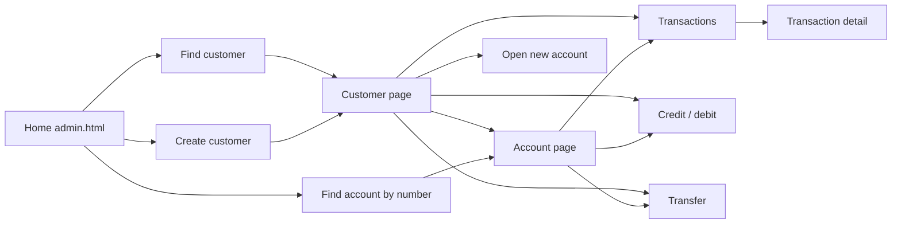

# Bank of Z Frontend — Vanilla JavaScript (Static HTML)

A zero-dependency vanilla JavaScript frontend for the Bank of Z Sample Application, using static HTML pages and Carbon Design System Web Components.

## Overview

- **Static HTML pages** — no router, traditional multi-page navigation
- **Vanilla JavaScript** (ES6 modules)
- **Carbon Web Components** loaded via IBM CDN
- **Native Fetch API** — no additional HTTP library
- **No build process** — files are served directly, no compilation needed
- **No runtime dependencies** — served by any static web server or container

## How the app is organised: customer first

Everything starts from a **customer**. You find (or create) a customer, see their accounts,
then act on an account.



### The customer ID rule

A customer ID is typed into **one box** everywhere and must start with:

- `C` for a CICS customer, e.g. `C0000000042`
- `I` for an IMS customer, e.g. `I000000015`

There is no default and no CICS/IMS dropdown. The prefix is carried in page URLs
(`?customerId=C0000000042`), so every page knows which system it is talking to.

### The IMS rule

The frontend only calls IMS where the backend has a route. Everywhere else it stops with a
clear "not implemented for IMS" message and never falls back to CICS.

| Action | CICS | IMS |
|---|---|---|
| View / update customer, list accounts | yes | yes |
| View account, balances | yes | yes (taken from the customer's account list) |
| Credit / debit | yes | yes |
| Create / delete customer | yes | not implemented |
| Create / update / delete account | yes | not implemented |
| Transfer | yes | not implemented |
| Transactions | yes | not implemented |

The guards live in `js/api.js` (`imsNotImplementedError`), so a page cannot call IMS by accident.

### Sort code

The sort code is always `987654` and is not user-editable. It is not shown on any form;
`js/api.js` adds `config.defaults.sortCode` to requests that need it.

## Pages

| Page | Purpose |
|---|---|
| `index.html` | Redirects to `admin.html` |
| `admin.html` | Home: **Find customer**, **Create customer**, **Find account by number** |
| `customer-create.html` | Create a CICS customer, then go to their customer page |
| `customer-details.html` | **Customer hub**: profile, edit, delete (with confirmation), accounts table with per-account actions, open new account. Shows a lookup when no `?customerId=` is given |
| `account-create.html` | Open an account for a customer |
| `account-details.html` | Account summary, edit terms, close account (with confirmation), links to credit/debit, transactions and transfer |
| `account-deposit.html` | Credit or debit an account |
| `account-transactions.html` | Transaction history with date filters and paging |
| `transaction-details.html` | A single transaction |
| `account-transfer.html` | Transfer from an account. Destination is either an account number (press Enter) or a customer ID, which lists that customer's accounts to choose from |

Deleting a customer or account is only possible from its detail page, behind a confirmation dialog.
Pages that need a customer or account but were opened without one show the same customer lookup
and an account picker, so every page can also be reached directly from the header.

## Project Structure

```
src/frontend/
├── index.html                  # Redirects to admin.html
├── admin.html                  # Home
├── customer-create.html
├── customer-details.html       # Customer hub
├── account-create.html
├── account-details.html
├── account-deposit.html        # Credit / debit
├── account-transactions.html
├── account-transfer.html
├── transaction-details.html
├── config.js                   # API base URL and default sort code
├── css/
│   ├── carbon-styles.min.css   # Carbon styles
│   ├── main.css                # Design tokens, cards, stats, forms, tables
│   ├── pages.css               # Shared page shell and page-specific layout
│   └── carbon-overrides.css    # Small Carbon tweaks
├── js/
│   ├── api.js                  # API service layer (fetch) + IMS guards
│   ├── utils.js                # Formatting, validation, modals
│   ├── carbon.js               # Loads every Carbon component (one script per page)
│   └── components/
│       ├── headers.js          # Header + top navigation
│       ├── layout.js           # Page shell: breadcrumb, title, notifications
│       └── lookup.js           # Customer ID parsing/lookup, account loading, URLs
└── assets/
    └── images/
```

## Shared building blocks

Every page has the same skeleton, so the breadcrumb, title and content share one left edge:

```html
<div id="header-container"></div>
<main class="page">
    <section class="page-banner"><div class="page-inner" id="banner"></div></section>
    <section class="page-content">
        <div class="page-inner">
            <div id="notification-container"></div>
            <div id="content"></div>
        </div>
    </section>
</main>
<script type="module" src="js/carbon.js"></script>
```

- **`js/carbon.js`** — the single list of Carbon components. Add a component here once, not on each page.
- **`js/components/layout.js`** — `mountPage({crumbs, title, subtitle})`, `setBanner`, `notify`, `clearNotification`, `errorMessage`.
- **`js/components/lookup.js`** — `parseCustomerRef` (the C/I rule), `customerLookupHtml` / `bindCustomerLookup` (the one lookup box), `readContext` (reads `?customerId=&accountId=`), `fetchCustomerAccounts`, `loadAccountContext`, and `urls` (link builders so every page links the same way), and `datePickerHtml` / `readDatePicker` (date fields use Carbon date pickers showing `dd/mm/yyyy`; `readDatePicker` returns the ISO `YYYY-MM-DD` the API expects).
- **`js/utils.js`** — `showConfirmModal` for destructive actions, plus formatting and validation.

## Configuration

Edit `config.js`. By default the API base URL is `/api` on port 3001 (proxied by nginx in the
dev setup), otherwise `<protocol>://<host>:9080/api` (or `:9444` for HTTPS):

```javascript
export const config = {
    api: { baseUrl: /* derived from the page location */ },
    defaults: { sortCode: '987654' }
};
```

## Styling

The pages use Carbon's light styles with a dark (`cds--g100`) header. Colours, spacing and
widths are defined as `--bz-*` tokens at the top of `css/main.css`; shared layout is in
`css/pages.css`.

## API Integration

The API client in `js/api.js` follows `src/api/src/main/api/openapi.yaml`:

- Customers: `GET/PUT/DELETE /customers/{id}`, `POST /customers`, `GET /customers/{id}/accounts` (plus `/ims/...` equivalents for get, update and accounts)
- Accounts: `GET/PUT/DELETE /accounts/{id}`, `POST /accounts`, `GET /accounts/{id}/balances`, `POST /accounts/{id}/deposit`, `POST /accounts/{id}/transfer`, `GET /accounts/{id}/transactions`

There is no customer search by name; the customer ID is the only way in.

## Deployment

The frontend is plain static HTML — serve the contents of `src/frontend/` with any web server or container.

For local development with Docker, see [`dev/README.md`](../../dev/README.md).

Ensure your backend API has CORS enabled for the origin serving the frontend, or configure a reverse proxy to route API requests to the backend on the same origin.

## Development

### Adding a New Page

1. Copy the skeleton above from an existing page (for example `account-deposit.html`)
2. Call `mountPage({ crumbs, title })` from `js/components/layout.js`
3. Use `customerLookupHtml` / `bindCustomerLookup` if the page needs a customer, never a custom input
4. Link to other pages with `urls.*` from `js/components/lookup.js`
5. If the action has no IMS backend route, call the `api.js` method with the customer's system so the guard produces the "not implemented for IMS" message
6. Add a link from the customer or account page where it belongs

### Adding API Methods

Add methods to `js/api.js`, and throw `imsNotImplementedError(...)` for `system === 'IMS'` if there is no IMS route:

```javascript
async myNewMethod(id, data, system = 'CICS') {
    if (system === 'IMS') throw imsNotImplementedError('Doing the thing');
    return this.request(`${this.configuration.baseUrl}/my-endpoint/${id}`, {
        method: 'POST',
        body: JSON.stringify(data)
    });
}
```

## Troubleshooting

### CORS Issues

Ensure the backend API has CORS enabled for the origin serving the frontend, or configure a reverse proxy to route API calls to the backend on the same origin.

### Carbon Components Not Loading

1. Check internet connectivity — Carbon Web Components are loaded from IBM CDN
2. Verify CDN URLs are accessible: `https://1.www.s81c.com/common/carbon/web-components/version/v2.47.0/`
3. Check the browser console for 404 errors or CORS issues
4. Confirm the component is listed in `js/carbon.js`

### API Connection Failed

1. Verify the backend is running and accessible
2. Check `config.js` for the correct API base URL
3. Check the browser console for errors

## License

Apache-2.0

## Contributing

See `CONTRIBUTING.md` in the root directory.

---

Built with Vanilla JavaScript, Static HTML, and Carbon Design System.
